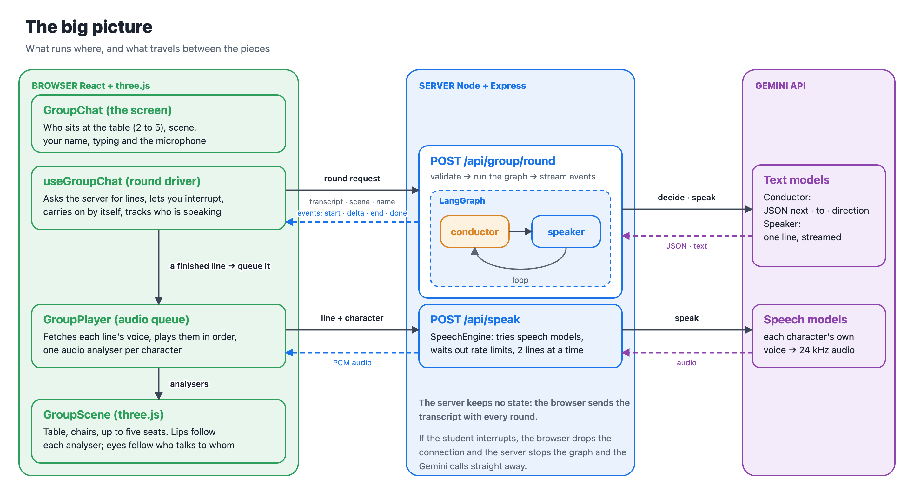

# Group conversation

Up to four characters sit around a table and talk with the student and with each other, like a small class. A **conductor** decides who speaks next, so the conversation flows instead of going round in a circle.

## Diagrams

| | |
|---|---|
| [The big picture](diagrams/1-overview.png) | what runs in the browser, on the server and at Gemini, and what travels between them |
| [One round is a LangGraph loop](diagrams/2-langgraph.png) | the state graph: conductor, speaker, and when it ends |
| [How the conductor chooses](diagrams/3-conductor.png) | the model proposes, plain rules decide, who a line is for |
| [One round, step by step](diagrams/4-sequence.png) | from something you say to a character speaking |
| [The conversation's states](diagrams/5-states.png) | idle, running and waiting in the browser |



## How a round works

The browser asks the server for a *round*: a few lines from the characters, ending when the floor passes to the student. The server runs the round as a [LangGraph](https://langchain-ai.github.io/langgraphjs/) state graph and streams each line as it is written.

```
        ┌────────────┐  someone speaks   ┌──────────┐
START ─▶│ conductor  │──────────────────▶│ speaker  │
        └────────────┘◀──────────────────└──────────┘
              │          (next line)
              │ hand to the student, or the turn budget is used up
              ▼
             END
```

- **conductor** (`src/group/conductor.ts`, `llm.ts`): a small model call returns JSON `{ next, direction }` against a schema. The model only *proposes*. `guard()` then enforces the rules in plain code: someone always answers at the start of a round; the round ends after `GROUP_MAX_TURNS` lines; the speaker must be at the table; nobody speaks twice in a row. If the model fails or returns nonsense, `pickNext()` chooses by rules (whoever was addressed by name, the teacher after the student speaks, otherwise whoever spoke least recently).
- **speaker** (`src/group/graph.ts`, `prompts.ts`): writes one character's line, streamed token by token. Each speaker gets their own persona and role, the other characters, the scene, and the same strict CEFR level rules as the one-to-one teacher (`levelRules()` in `src/teacher.ts`).
- **Turn budget**: a round is at most 4 lines. If it ends right after a question, the floor goes to the student. Otherwise the browser lets the characters continue on their own for up to two more rounds, then waits ("Keep talking").

The graph depends on a two-method interface (`GroupLLM`: `decide`, `speak`), so models can be swapped per character (`model` in `src/characters.ts`; the conductor uses `GEMINI_CONDUCTOR_MODEL`) and tests use a scripted fake.

## Why it responds quickly

The time before the first voice is a chain: the request, a routing call, the line being written, the line being turned into speech, and playback. Each link is kept short:

- **The first line of a round has no routing call.** The student is waiting for it, so its speaker is chosen by rules (whoever was named, else the teacher), which costs nothing. The model conductor only runs for later lines, while earlier lines are still being spoken, so its delay is hidden. No model call is made either when the round's line budget is used up (`GROUP_FAST_START=false` turns the quick start off).
- **Speech is streamed.** The server passes the audio to the browser as the speech model produces it, and the browser starts playing at the first chunk instead of waiting for the whole line. The fastest speech model is tried first (`gemini-3.8-flash-lite-tts`; pin the fuller `gemini-3.8-flash-tts` with `GEMINI_TTS_MODEL`).
- **Everything overlaps.** A line's voice is requested the moment the line is written, so while one line plays the next ones are already being written and spoken for.
- **The next round starts early.** When the group carries on by itself, the browser asks for the next round as soon as at most two lines of the current one are left to hear, so there is no silent gap.
- **Nothing waits on a slow part.** The conductor model has a time limit (`GROUP_CONDUCTOR_TIMEOUT_MS`, 2.5 s; it usually answers in about a second) after which the rules choose; a voice that hasn't started in 8 s is replaced by the browser's voice for that line; a model that doesn't exist is never tried twice; a rate limit is waited out once; and after every voice option has failed they are left alone for 30 s.
- **Short prompts.** Only the latest lines go to the models (12 to the conductor, 20 to a speaker).

Set `GROUP_LOG_TIMING=1` to log when each line is finished and when the first audio of each voice arrives, to see where time goes.

## Voices and the table

- Each line is spoken in the character's own Gemini voice. `POST /api/speak` uses a Gemini TTS model (`GEMINI_TTS_MODEL`) with the character's voice and a delivery style, and returns raw 24 kHz PCM. `SpeechEngine` (`src/group/tts.ts`) is built to keep the natural voices working and quick: it tries each speech model (the lite one, `gemini-3.8-flash-tts`, a 3.1 preview and a 2.5 model; `GEMINI_TTS_MODEL` pins one) with the streaming Interactions call, the single-response Interactions call (automatic retries off in both, because the SDK's retry can fail while re-sending and hide the real error) and the classic `generateContent` call, and remembers which worked. Speech models allow few requests per minute, so it keeps only `GROUP_TTS_CONCURRENCY` (2) requests running, waits out a 429 once, never retries a model that doesn't exist, and after everything has failed it stops trying for 30 seconds so lines go straight to the browser voice. The error names the model, API and HTTP status. If a voice can't be fetched, the line is spoken with the browser's voice instead: each character gets a different installed voice (preferring Premium, Enhanced and Google voices) with only a slight pitch and pace change, and the page says why the natural voices aren't being used.
- Lines are fetched as soon as they are written and played back to back, so the next voice is normally ready when the previous one ends. A line only appears in the transcript when it starts playing.
- Every character plays through its own `AnalyserNode`. The 3D scene (`web/src/avatar/GroupScene.tsx`) reads it to move that character's mouth, exactly as in the one-to-one view (shared "rigs" in `cartoonRig.ts` and `vrmRig.ts`). Everyone looks at whoever is speaking; the speaker leans in. When a line is for one person, the speaker looks at them and they look back, and the others glance between the two. A line for the student is spoken to the camera.
- Name tags above each head show who is speaking (blue) and who is about to speak ("…", purple).
- The table is in a furnished room (window, panelled wall, pendant lamp, plant, chairs, wooden floor) with soft shadows. The colours change with the chosen scene, and the camera backs away as more people sit down, so up to four always fit. Seated cartoon characters rest their hands on the table; VRM characters keep their own arms. Seats are spaced by `web/src/avatar/seating.ts` so that neighbours are always at least one seat gap apart and characters never overlap; the rule is covered by `src/group/seating.test.ts`. Name labels are plain HTML positioned over the canvas, so the text stays sharp and shows a speaking indicator (animated bars) or a thinking indicator (bouncing dots).

## Interrupting

The student can jump in at any time by typing, pressing **Stop**, or saying something with the microphone on. The browser drops the connection, which cancels generation on the server (`AbortSignal` into LangGraph and the model call), stops the audio, and discards lines that were written but not yet heard. The next round starts from what the student actually saw and heard.

## API

`POST /api/group/round` → server-sent events

```jsonc
// request
{ "language": "Turkish", "level": "B1",
  "participants": ["professor", "luna", "rex"],       // 2 to 4 distinct ids
  "transcript": [{ "speaker": "user", "text": "Merhaba" }],   // last 40 lines
  "scene": "cafe" }                                    // a scene id, or the student's own topic
// events
{ "type": "start", "speaker": "luna" }                 // a character begins writing
{ "type": "delta", "speaker": "luna", "text": "Mer" }  // streamed text
{ "type": "end",   "speaker": "luna", "text": "Merhaba, Rex!", "addressee": "rex" }   // or "user", or absent for the whole table
{ "type": "done",  "awaitUser": true }                 // or { "type": "error", "message": … }
```

`POST /api/speak` `{ "text", "character" }` → `application/octet-stream` (16-bit mono PCM, 24 kHz; `X-Sample-Rate` header).

`GET /api/config` also lists the characters, scenes and the 2 to 4 limit for the UI.

**Who a line is for** is decided on the server (`detectAddressee` in `conductor.ts`): whoever is called by name first (another character, or the student by their own name), else the person the conductor intended (it returns a `to` field), else the person who spoke just before. The speaker is told who to talk to, so they use that person's name.

**The student's name** (the "Your name" field) is cleaned by `parseStudentName` (letters, spaces, hyphens, apostrophes and full stops; at most three words and 30 characters) and sent with every request. The characters are asked to use it naturally now and then, and the script labels the student's lines with it. It also works in the one-to-one teacher and in voice calls; changing it starts a new conversation.

The server is stateless: the browser sends the transcript with every round, so restarts and multiple instances need no shared state.

## Safety and cost

- Everything the client sends is validated (`src/group/validate.ts`): known character ids (own properties only), 2 to 4 distinct participants, transcript speakers must be at the table, lines capped at 600 characters, language and level from allowlists. Free text only reaches prompts as quoted conversation.
- Both routes honour `ACCESS_CODE`. At most `GROUP_MAX_ROUNDS` rounds and `GROUP_MAX_SPEECH` speech requests run at once (429 beyond that).
- A round costs up to 4 speaker calls, 4 conductor calls and 4 TTS calls. Auto-continue is capped at 3 rounds in a row. Use faster or smaller models by setting `GEMINI_CONDUCTOR_MODEL` and per-character `model`.

## Tests

`npm test` runs `src/group/*.test.ts` with Node's test runner: request validation, the conductor rules, the graph with a scripted model (turn order, budget, fallback, interruption, errors), prompts, the WAV helper, and the HTTP routes end to end with a fake model (SSE stream, access code, cancellation when the client disconnects).

## Limits and ideas

- **Voice interruption**: the microphone pauses while the group talks (the browser's speech recognition would hear the speakers). You can still type or press Stop. True talk-over needs echo-cancelled capture and one Gemini Live session per character.
- **Other providers**: `GroupLLM` is the seam for non-Gemini models; only a Gemini implementation exists.
- **Voice choices** are guesses from Google's style labels, since voices aren't labelled male or female. Change them in `src/characters.ts`.
- **The conductor adds a model call before every line.** It runs while the previous line is still playing, so it is normally hidden.
